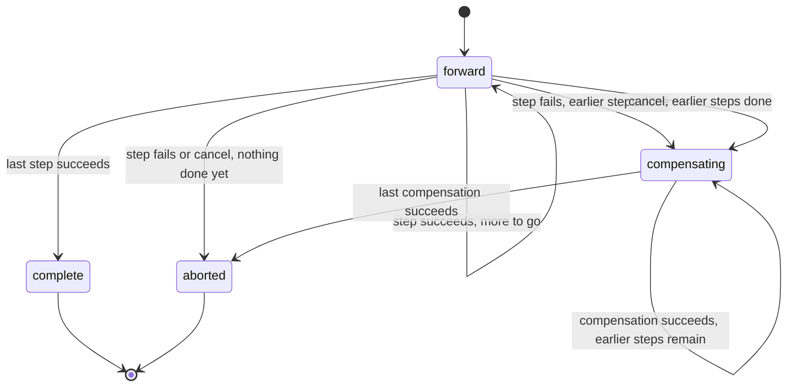
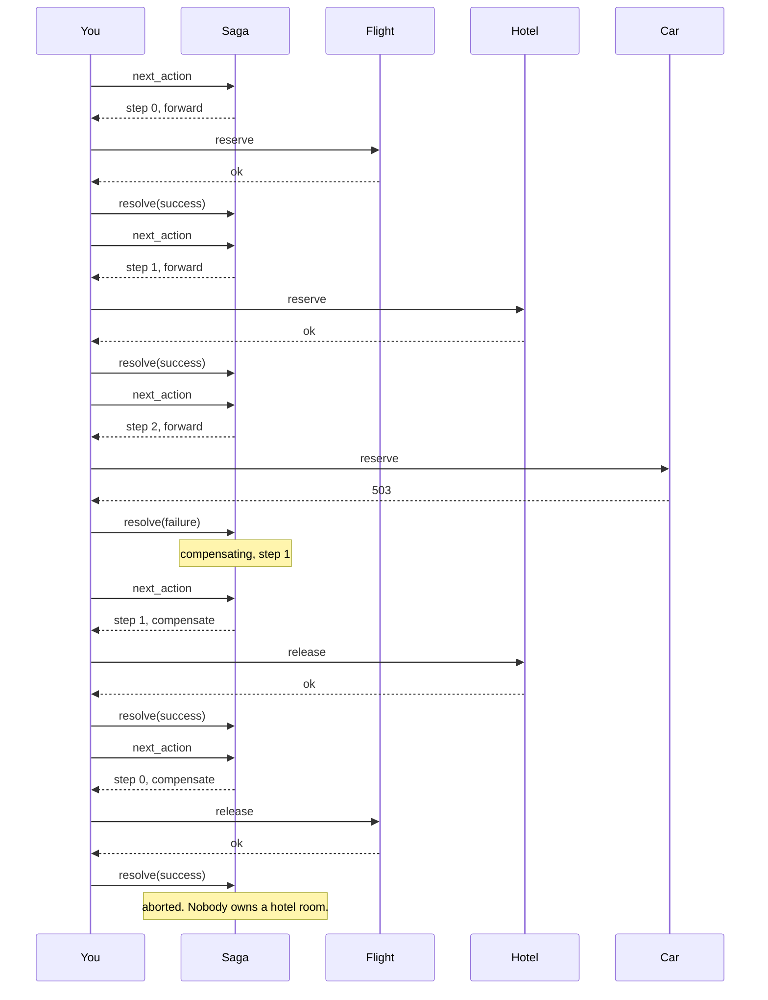

# SagaMachines

> The return itinerary for expeditions that don't make it. 🔄

A saga coordinator for Ruby. You tell it how many steps the journey has, it tells you which step to run next, you report how it went. When a step fails, it walks you back through every step that already succeeded, in reverse, until the world looks like you never left.

## Quick Start

```bash
gem 'saga_machines'
```

```ruby
saga = SagaMachines::Saga.new(order.id, steps: 3)

while (action = saga.next_action)
  outcome = case [action.kind, action.step]
            when [:forward, 0]    then reserve_flight(order)
            when [:forward, 1]    then reserve_hotel(order)
            when [:forward, 2]    then reserve_car(order)
            when [:compensate, 0] then release_flight(order)
            when [:compensate, 1] then release_hotel(order)
            when [:compensate, 2] then release_car(order)
            end
  saga.resolve(action, outcome ? :success : :failure)
end

saga.progress # => [:complete, nil] or [:aborted, nil]
```

That's the whole gem. One object, five methods, no DSL to memorize at 3 AM.

## A Message to the Resistance

So you shipped the checkout flow. Flight reserved, hotel reserved, then the car rental API returned a 503 and your customer now owns a hotel room in Lisbon with no way to get there.

You know what the fix is. You've known since the first time you drew three boxes on a whiteboard and an arrow labeled "rollback" that nobody ever implemented. The fix is a saga: every forward step gets a compensating step, and when something breaks, you run the compensations in reverse order.

The hard part was never the idea. The hard part is the bookkeeping. Which steps succeeded? Which compensation are we on? Did that retry already run? Can we still cancel? That bookkeeping is this gem. The reservations and the cancellations are still yours. We just promise never to lose count.

## Chapter 1: Stardate 2025.186, the AMS Garcia-Molina

> **AMS Garcia-Molina**, NCC-4217, *Garcia-Molina*-class recovery carrier.
> A failed expedition needs a return itinerary, not a promise to reverse time.

The carrier doesn't undo anything itself. It holds the flight plan. Three legs out, and if leg three is scrubbed, it orders legs two and one flown back, in that order, by the same crews that flew them out.

Somewhere on the bridge, a junior officer suggests:

```ruby
def book_trip
  reserve_flight
  reserve_hotel
  reserve_car
rescue
  # TODO: undo stuff
end
```

"That," says the recovery officer, "is how customers end up owning hotel rooms."

## The Flight Plan

Every saga is in exactly one of four states. Two of them are final.



And here is the Lisbon trip, the day the car rental went down:



## How a Journey Unfolds

### Forward

Each call to `next_action` hands you the next leg. It carries a `step` number and a `kind`, which is `:forward` on the way out.

```ruby
saga = SagaMachines::Saga.new(42, steps: 3)

action = saga.next_action
action.step  # => 0
action.kind  # => :forward
saga.resolve(action, :success)

saga.progress # => [:forward, 1]
```

Resolve every step with `:success` and the saga lands at `[:complete, nil]`. `next_action` returns `nil` from then on. There is nothing left to do.

### Something breaks

Report `:failure` on a forward step and the saga turns around. It only compensates steps that actually succeeded, and it compensates them newest first.

```ruby
saga = SagaMachines::Saga.new(42, steps: 4)
3.times { saga.resolve(saga.next_action, :success) } # steps 0, 1, 2 done

failed = saga.next_action                           # step 3
saga.resolve(failed, :failure)

saga.progress     # => [:compensating, 2]
saga.next_action  # => step 2, kind :compensate
```

Step 3 never succeeded, so it's never compensated. Step 2 is undone first, then 1, then 0. When the last compensation lands, progress reads `[:aborted, nil]`.

### A compensation fails too

Release-the-hotel can fail as easily as reserve-the-hotel. The saga doesn't skip it and doesn't give up. It hands you the same step again with a fresh attempt.

```ruby
undo = saga.next_action            # step 2, :compensate
saga.resolve(undo, :failure)

again = saga.next_action           # step 2, :compensate, new attempt
undo.same_key?(again)              # => true, same leg
saga.resolve(undo, :success)       # => false, that attempt is over
saga.resolve(again, :success)      # => true
```

The old handle is dead. A late reply to a retry you already moved on from cannot advance the saga, no matter how convincing it looks.

### Changing your mind

`cancel` is allowed between actions, never during one. If a step is in flight, you don't get to pretend it isn't.

```ruby
saga = SagaMachines::Saga.new(7, steps: 2)
saga.resolve(saga.next_action, :success)   # step 0 done, nothing pending

saga.cancel      # => true
saga.progress    # => [:compensating, 0]
```

Call `cancel` while an action is outstanding and it returns `false`. Resolve the action first, then cancel. A fresh saga with nothing done cancels straight to `[:aborted, nil]`.

## The Rules of the Carrier

- **Steps are exact.** `steps:` accepts 0, 1, 2, 3, 4, 8, or 16. Anything else raises `ArgumentError`. Zero steps is already complete.
- **Identity is an Integer** in `0..2**64-1`. Use your order id, your job id, whatever you'd put on the manifest. Floats and strings raise `TypeError`.
- **Every step is compensatable.** If you have a step that can't be undone, put it last, so nothing after it can fail.
- **A forward failure means nothing happened.** If the car API timed out and you don't know whether it booked, find out before you report. Reporting `:failure` on a step that secretly succeeded is how you leak a car.
- **Handles belong to one saga.** An action from one `Saga` instance is rejected by another, even with the same identity. `resolve` returns `false` for stale or foreign handles. It never raises for them.
- **Frozen means frozen.** `freeze` the saga and every mutation raises `FrozenError`.

## What You Think You're Doing vs Reality

### You Think: "I'll wrap it in a database transaction."
### Reality: Stripe is not in your database.

Transactions roll back rows. They do not unreserve a flight, refund a card, or recall an email. For anything that leaves your process, the only rollback is a forward action that cancels the previous one. That's a saga, and now you have one.

## What's Yours

The saga remembers where you are. It does not remember it for you across a crash. Persist the action before you execute it, persist the outcome before you resolve it, and on restart replay what you stored. It also doesn't schedule retries or wait for anything. Call `next_action` when you're ready, not before.

## License

MIT License. See [LICENSE.txt](LICENSE.txt) for details.

**Remember: In space, nobody can hear your rollback. But they can see the hotel charge on their statement.**
