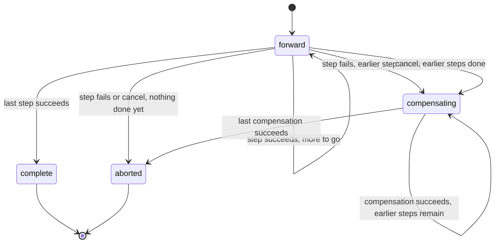
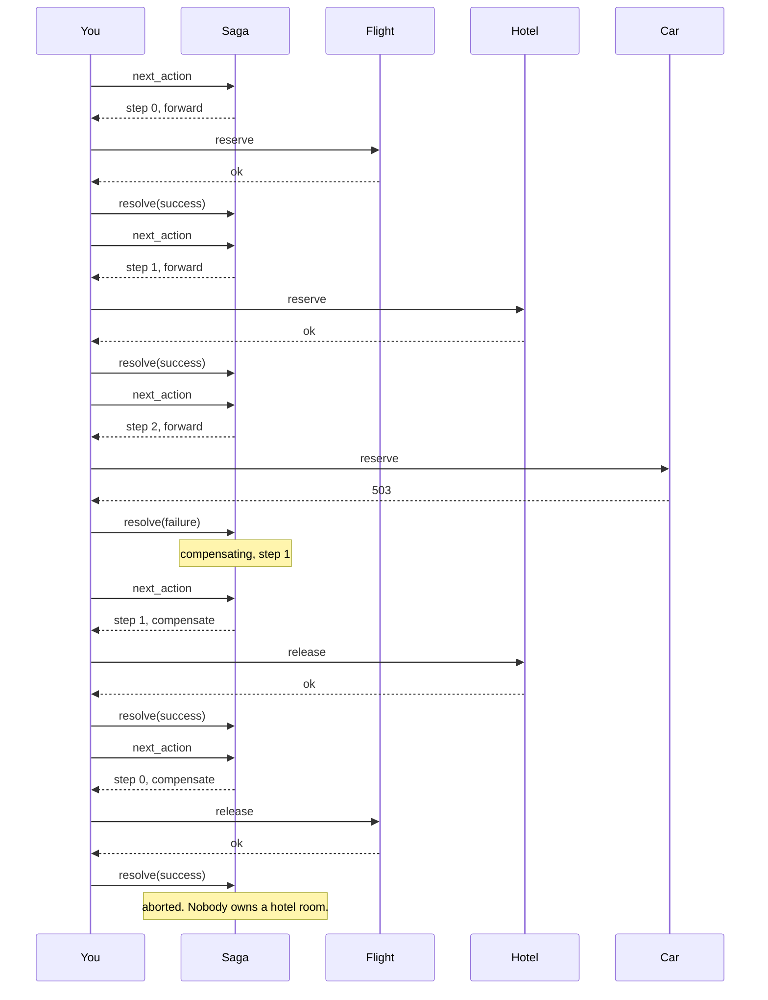

# SagaMachines

> The return itinerary for expeditions that don't make it. 🔄

A saga coordinator for Ruby. You tell it how many steps the journey has, it tells you which step to run next, you report how it went. When a step fails, it walks you back through every step that already succeeded, in reverse, until the world looks like you never left.

## Quick Start

```bash
gem 'saga_machines'
```

```ruby
saga = SagaMachines::Saga.new(3, SagaMachines::SagaId.new(order.id))

while (action = saga.next_action)
  outcome = case [action.kind, action.step]
            when [:forward, 0]    then reserve_flight(order)
            when [:forward, 1]    then reserve_hotel(order)
            when [:forward, 2]    then reserve_car(order)
            when [:compensate, 0] then release_flight(order)
            when [:compensate, 1] then release_hotel(order)
            when [:compensate, 2] then release_car(order)
            end
  saga.resolve(action, outcome ? :success : :failure)
end

saga.progress # => :complete or :aborted
```

That's the whole gem. One object, three verbs (`next_action`, `resolve`, `cancel`), no DSL to memorize at 3 AM. Every call answers with what happened or a symbol saying why it didn't, and a call that wasn't honoured changed nothing.

## A Message to the Resistance

So you shipped the checkout flow. Flight reserved, hotel reserved, then the car rental API returned a 503 and your customer now owns a hotel room in Lisbon with no way to get there.

You know what the fix is. You've known since the first time you drew three boxes on a whiteboard and an arrow labeled "rollback" that nobody ever implemented. The fix is a saga: every forward step gets a compensating step, and when something breaks, you run the compensations in reverse order.

The hard part was never the idea. The hard part is the bookkeeping. Which steps succeeded? Which compensation are we on? Did that retry already run? Can we still cancel? That bookkeeping is this gem. The reservations and the cancellations are still yours. We just promise never to lose count.

## Chapter 1: Stardate 2025.186, the AMS Garcia-Molina

> **AMS Garcia-Molina**, NCC-4217, *Garcia-Molina*-class recovery carrier.
> A failed expedition needs a return itinerary, not a promise to reverse time.

The carrier doesn't undo anything itself. It holds the flight plan. Three legs out, and if leg three is scrubbed, it orders legs two and one flown back, in that order, by the same crews that flew them out.

Somewhere on the bridge, a junior officer suggests:

```ruby
def book_trip
  reserve_flight
  reserve_hotel
  reserve_car
rescue
  # TODO: undo stuff
end
```

"That," says the recovery officer, "is how customers end up owning hotel rooms."

## The Flight Plan

Every saga is in exactly one of four states. Two of them are final.



And here is the Lisbon trip, the day the car rental went down:



## How a Journey Unfolds

### Forward

Each call to `next_action` hands you the next leg. It carries a `step` number and a `kind`, which is `:forward` on the way out. The step count comes first and the identity second, the way the engine room writes `Saga::<3>::new(id)`.

```ruby
saga = SagaMachines::Saga.new(3, SagaMachines::SagaId.new(42))

action = saga.next_action
action.step  # => 0
action.kind  # => :forward
saga.resolve(action, :success)   # => :resolved

saga.progress # => #<data SagaMachines::Forward step=1>
```

Resolve every step with `:success` and the saga lands at `:complete`. `next_action` returns `nil` from then on. There is nothing left to do.

Ask twice before resolving and you get the same action back, same attempt. Nothing new is issued until the pending one is resolved.

### Something breaks

Report `:failure` on a forward step and the saga turns around. It only compensates steps that actually succeeded, and it compensates them newest first.

```ruby
saga = SagaMachines::Saga.new(4, SagaMachines::SagaId.new(42))
3.times { saga.resolve(saga.next_action, :success) } # steps 0, 1, 2 done

failed = saga.next_action                           # step 3
saga.resolve(failed, :failure)

saga.progress     # => #<data SagaMachines::Compensating step=2>
saga.next_action  # => step 2, kind :compensate
```

Step 3 never succeeded, so it's never compensated. Step 2 is undone first, then 1, then 0. When the last compensation lands, progress reads `:aborted`.

### A compensation fails too

Release-the-hotel can fail as easily as reserve-the-hotel. The saga doesn't skip it and doesn't give up. It hands you the same step again with a fresh attempt.

```ruby
undo = saga.next_action            # step 2, :compensate
saga.resolve(undo, :failure)

again = saga.next_action           # step 2, :compensate, new attempt
undo.key == again.key              # => true, same leg
undo.attempt == again.attempt      # => false, new try
saga.resolve(undo, :success)       # => :mismatch, that attempt was recorded as a failure
saga.resolve(undo, :failure)       # => :already_resolved, the report you already made
saga.resolve(again, :success)      # => :resolved
```

The old attempt can't advance the saga. Repeating the report you already made is fine and changes nothing; contradicting it is `:mismatch`; and once `again` is resolved, `undo` is simply `:stale`. A late reply to a retry you already moved on from gets nowhere, no matter how convincing it looks.

### Changing your mind

`cancel` is allowed between actions, never during one. If a step is in flight, you don't get to pretend it isn't.

```ruby
saga = SagaMachines::Saga.new(2, SagaMachines::SagaId.new(7))
saga.resolve(saga.next_action, :success)   # step 0 done, nothing pending

saga.cancel      # => :cancelled
saga.progress    # => #<data SagaMachines::Compensating step=0>
saga.cancel      # => :already_unwinding
```

Call `cancel` while a forward action is outstanding and it answers `:busy`. Resolve the action first, then cancel. A fresh saga with nothing done cancels straight to `:aborted`. Cancelling a saga that's already on its way back, by an earlier cancel or by a failure, is `:already_unwinding`: you asked for the return trip and it's underway. A saga that already landed at `:complete` answers `:concluded`.

### Two names on every action

An action carries two identities, and mixing them up is how duplicates get through.

```ruby
action.key      # => #<data SagaMachines::ActionKey saga=#<data SagaMachines::SagaId raw=42>, step=2, kind=:compensate>
action.attempt  # => #<data SagaMachines::AttemptId raw=5>
```

`key` is the **idempotency identity**: which saga, which step, which direction. It's the same for every retry of that leg, before and after a restart. Hand it to whatever keeps your effects from running twice.

`attempt` is the **handle for `resolve`**: issued by the saga for this one try and never again. `resolve` honours an action only if the saga issued that attempt, for that key.

Both are plain data, so an action can sit in a queue or a table row and be rebuilt when the reply comes back:

```ruby
row = [action.key.saga.raw, action.step, action.kind, action.attempt.raw]

key = SagaMachines::ActionKey.new(SagaMachines::SagaId.new(row[0]), row[1], row[2])
saga.resolve(SagaMachines::Action.new(key, SagaMachines::AttemptId.new(row[3])), :success)
```

No order id handy? `SagaMachines::SagaId.from_bytes("manifest-42")` hashes a name into one (FNV-1a, the same in every process).

### Scopes and restarts

An attempt is an Integer: the saga's scope in the top 16 bits, a sequence from 1 below. Two sagas in the same scope issue the same integers. If their replies could meet (one reply queue for many sagas), give each its own scope and a reply delivered to the wrong saga is `:stale` instead of a mix-up:

```ruby
saga = SagaMachines::Saga.with_scope(3, SagaMachines::SagaId.new(42), 7)
saga.next_action.attempt.scope   # => 7
```

The scope is not part of the `key`. The idempotency identity has to survive everything, a change of scope included.

A restart must not rewind the sequence, or an attempt that outlived it would name a new try. Save the snapshot after every answer and hand it back:

```ruby
saved = saga.snapshot   # => Snapshot(id, scope, progress, issued, settled)
saga = SagaMachines::Saga.restored(3, saved, 7)   # => a Saga, or RangeError
```

`restored` takes the scope explicitly and raises `RangeError` for a snapshot of another scope, or one no saga of that many steps could have reached. That check is exact, not a sniff test: the settled attempt can't be numbered lower than the tries that had to come before it (step 0's compensation is never attempt 1), and a saga that finished on a settlement has issued nothing since, so its `issued` is that attempt's number and not one more. The pending action is not in the snapshot: after a restart it's `:stale`, and `next_action` issues the same `key` under a fresh attempt. Whether the effect already ran is for your dedup ledger to say, which is exactly why the key didn't change. The last settlement is in the snapshot, so a redelivered reply to it is still `:already_resolved`. If you can't save the snapshot, start each incarnation in a scope no earlier one used.

## Every answer

Honoured answers say what happened. Refusals are symbols, one per reason, and a refused call changed nothing: not the progress, not the pending action, not the count.

| Call | Honoured | Refusals |
| --- | --- | --- |
| `next_action` | an `Action`; `nil` once `:complete` or `:aborted` | `:exhausted` |
| `resolve(action, outcome)` | `:resolved`, `:already_resolved` | `:stale`, `:mismatch` |
| `cancel` | `:cancelled`, `:already_unwinding` | `:concluded`, `:busy` |
| `progress` | `Forward(step)`, `Compensating(step)`, `:complete`, `:aborted` | |
| `pending` | an `Action` or `nil` | |
| `settled` | a `Settlement(action, outcome)` or `nil` | |
| `snapshot` | a `Snapshot(id, scope, progress, issued, settled)` | |
| `id`, `scope`, `issued`, `steps` | a `SagaId`; Integers | |
| `Saga.new(steps, id)`, `Saga.with_scope(steps, id, scope)` | a `Saga` | none: raises on malformed input |
| `Saga.restored(steps, snapshot, scope)` | a `Saga` | none: raises `RangeError` for saved state that isn't that saga's |

No answer records a clock: the saga takes no time, so every answer holds whatever the time.

What each refusal means:

- `:exhausted`: there's work left, but the scope's 2**48-1 attempts are spent. Not the same as `nil`, which means the journey is over.
- `:stale`: the attempt isn't one this saga can act on. It carries another scope or was never issued (answered before anything is looked up), or it's an earlier attempt that is neither pending nor the last one resolved.
- `:mismatch`: the attempt is the pending one or the last one resolved, but the action's key or the outcome isn't what the saga recorded. The record stands.
- `:busy`: a forward action is unresolved, so there's no cancelling yet.
- `:concluded`: the saga is `:complete`. There's nothing to cancel.

Repeats that are honoured, because the saga can prove them:

- `next_action` with an action pending: the same action again.
- `resolve` of the last action resolved, with the same outcome: `:already_resolved`. The saga remembers exactly one settlement, the last. Anything older is `:stale`.
- `cancel` on a saga already compensating or aborted: `:already_unwinding`.

## The Rules of the Carrier

- **Steps are exact.** The step count is the first argument and must be one of `SagaMachines::STEPS`: 0, 1, 2, 3, 4, 8, or 16. The engine takes the count at compile time, so those are the sizes built in; anything else raises `RangeError`. Zero steps is already complete.
- **Identity is a `SagaId`** wrapping an Integer in `0..2**64-1`. Use your order id, your job id, whatever you'd put on the manifest. A bare Integer, a Float or a String raises `TypeError`; out of range raises `RangeError`.
- **Refusals are symbols and never raise.** Only malformed input raises: `TypeError` for the wrong class, `RangeError` for a value the core doesn't accept, an outcome, kind or progress symbol that doesn't exist included. `ArgumentError` is Ruby's own, for the wrong number of arguments.
- **Values are valid or don't exist.** Every value validates when it's built, by the gem or by you, through the engine room: `AttemptId.new(0)` raises `RangeError` (no saga issues a sequence of zero), so does `ActionKey.new(id, -1, :forward)` or a `Snapshot` whose settlement belongs to another saga, another scope, or an attempt past `issued`. What depends on the step count is for `Saga.restored` to judge. The values are final: subclassing one raises `TypeError` and `allocate` is gone. That stops accidents, not reflection (a named subclass still leaves its constant behind; `Marshal.load` and a hand-bound `Data#initialize` skip the check), so the engine room is the authority: every value it reads back (the `SagaId` a saga starts with, the `Action` you resolve, the `Snapshot` you restore, and every value nested in them) must be exactly its class (`TypeError` otherwise, a subclass included), and is read natively and checked again (`RangeError`). A forged value never reaches the saga and never earns `:stale` or `:mismatch`.
- **A raised answer loses nothing.** The value classes are resolved once, when the extension loads. Building the `Action` runs Ruby code (`new`, which a reopened class can redefine), so `next_action` decides on a copy, builds the `Action`, and keeps the copy only if the saga is still unfrozen and unchanged. If building it raises, nothing was issued and the next `next_action` issues the same attempt; a `new` that freezes the saga raises `FrozenError`, one that calls back in and changes it raises `RuntimeError`, and in both cases the outer call is not applied.
- **No clock.** The saga takes no time and reads none. When to retry is yours.
- **Every step is compensatable.** If you have a step that can't be undone, put it last, so nothing after it can fail.
- **A forward failure means nothing happened.** If the car API timed out and you don't know whether it booked, find out before you report. Reporting `:failure` on a step that secretly succeeded is how you leak a car.
- **Attempts belong to one scope.** An action from a saga of another scope is `:stale`, even with the same identity. Two sagas in the same scope issue the same attempt integers, so give sagas that share a reply path their own scopes.
- **Frozen means frozen.** `freeze` the saga and every mutation raises `FrozenError`.

## What You Think You're Doing vs Reality

### You Think: "I'll wrap it in a database transaction."
### Reality: Stripe is not in your database.

Transactions roll back rows. They do not unreserve a flight, refund a card, or recall an email. For anything that leaves your process, the only rollback is a forward action that cancels the previous one. That's a saga, and now you have one.

## What's Yours

The saga remembers where you are. It does not remember it for you across a crash. Persist the action before you execute it, persist the outcome before you resolve it, save `snapshot` after each answer, and on restart bring it back with `Saga.restored`. It also doesn't schedule retries or wait for anything. Call `next_action` when you're ready, not before.

Deduplicating the effects is yours too. The engine room can claim an action's key straight in a `dedup-machines` ledger (`Action::claim_in`), because a Rust ledger can be keyed by the whole `ActionKey`. The `DedupMachines::Ledger` gem is keyed by one Integer, and a saga id, a step and a kind don't fit in one without inventing a hash the core doesn't have. So the gem hands you `action.key` and stops there: map it to the Integer you already own (the row id of that step, say) and call `ledger.claim(that_integer, now, ttl)` yourself.

## License

MIT License. See [LICENSE.txt](LICENSE.txt) for details.

**Remember: In space, nobody can hear your rollback. But they can see the hotel charge on their statement.**
